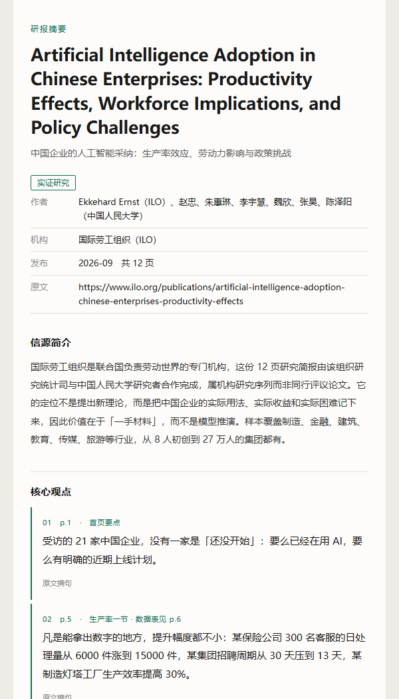
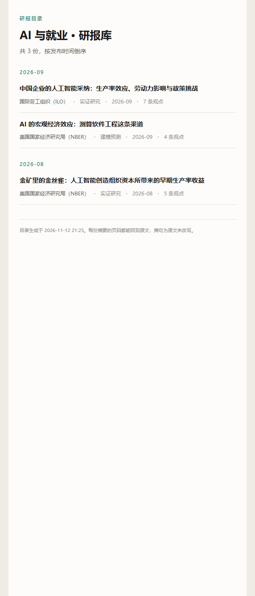

# AI 就业研报雷达

一个给 AI agent 用的技能包：把「读一份研报、写一份摘要」做成可复现的流水线。

说一句「启动」，它会去固定的机构白名单里找 AI 与就业相关的新报告，下载原件、盖文件指纹、按十九条固定规范提炼，最后产出两样东西——一份手机上五分钟读完的竖屏长页，和一份按月份排好的总目录。

它不是「让 AI 随便总结一下」。每句话都能回到原文页码，每个数字都带口径，格式每次都长得一样。

<p align="center">
  
  
</p>

<p align="center"><sub>左：单份摘要长页（`examples/screenshot-page-full.png` 是完整版）　右：总目录页</sub></p>

## 为什么需要它

用 AI 总结研报，最常见的三个毛病：

1. **每次写法不一样**。这次五条要点，下次三段散文，后天开始自由发挥。
2. **数字没有口径**。把「任务暴露率」写成「失业率」，把「工时占比」写成「岗位占比」，读的人无从核对。
3. **没有出处**。说「研究显示」，但找不到第几页。

这个技能把三件事都钉死了：五项内容结构固定、十九条硬规则、每条观点必须挂页码和原文摘句。规则全部写在 `references/spec.md` 里，可读、可改、可核对。

## 快速开始

### 装

把整个目录复制到你的技能目录下（路径按你用的 agent 定）：

```bash
# WorkBuddy / CodeBuddy
git clone https://github.com/claresta3qu9p20-stack/ai-employment-radar.git ~/.workbuddy/skills/ai-employment-radar

# Claude Code
git clone https://github.com/claresta3qu9p20-stack/ai-employment-radar.git ~/.claude/skills/ai-employment-radar
```

也可以用项目级目录（`.workbuddy/skills/` 或 `.claude/skills/`），跟着仓库走。

### 用

对 agent 说：

```
启动
```

它会自我介绍，然后问你三件事：要多久以内的报告、搜到的这批是否全部纳入、有没有哪份抓不下来需要你手动放文件。除此之外不会打断你。

产出落在你当前项目的 `ai-jobs/` 下：

```
ai-jobs/reports/
  index.html                          总目录，先看这个
  2026-09-ilo-ai-chinese-enterprises/
    raw.pdf                           原件
    summary.json                      提炼结果
    index.html                        成品长页
```

### 手上有 PDF，只想提炼一份

跳过检索和下载，直接进提炼：

```
@某份报告.pdf 按 ai-employment-radar 的规范提炼一份
```

### 不用 agent，纯手动跑

脚本只用 Python 标准库，不装任何依赖。

```bash
# 1. 下载原件并盖指纹（也可手动把 PDF 存成 raw.pdf）
python scripts/fetch_pdf.py <报告详情页URL> reports/2026-09-某某机构-短名

# 2. 抽文本，保留分页标记，存成 content.md
#    有 workbuddy-pdf 用它；没有就 pdftotext -layout，或用 PyMuPDF 逐页导出
#    然后照 references/spec.md 写 summary.json，格式见 examples/sample-summary.json

# 3. 渲染单份长页
python scripts/render.py reports/2026-09-某某机构-短名/summary.json \
                        reports/2026-09-某某机构-短名/index.html

# 4. 重建总目录
python scripts/build_index.py reports/
```

`examples/sample-page.html` 是渲染好的成品，可以直接在浏览器打开看效果。

## 目录结构

```
.
├── SKILL.md                 agent 读的说明书：九步流程 + 三次交互 + 硬边界
├── references/
│   ├── spec.md              提炼规范：十九条硬规则、语言规则、输出结构、八条自检
│   ├── sources.md           白名单十家、实测状态、各站抓取要点、简报表口径
│   └── failures.md          失败样本库：被退回的案例与用户原话
├── assets/
│   ├── style.css            页面样式（摘要页与目录页共用）
│   ├── page.html            单份摘要页骨架
│   └── catalog.html         总目录页骨架
├── scripts/
│   ├── fetch_pdf.py         详情页 → 解析 PDF 链接 → 下载 → 校验 → sha256
│   ├── render.py            summary.json → 竖屏长页
│   └── build_index.py       reports/ → 总目录页
└── examples/                一份真实报告的 summary.json、渲染成品、截图
```

## 怎么改成你要的样子

| 想改什么 | 改哪儿 |
|---|---|
| 换机构（不看就业，看别的领域） | `references/sources.md` 的十家白名单 |
| 改提炼规则（几项内容、怎么写） | `references/spec.md`。**先改规则再改流程**，否则下次还会跑偏 |
| 改版式（配色、宽度、字号） | `assets/style.css` 顶部的 `:root` 变量 |
| 改页面结构（加一块、删一块） | `assets/page.html`，占位符用 `$变量名` |
| 改交互（少问一次、多问一次） | `SKILL.md` 的「全程只有三次交互」与对应步骤 |

改了规范之后建议先拿 `examples/sample-summary.json` 重渲染一遍，确认版式没坏。

## 已知边界

- **只抓白名单里的十家，不是全网。** 其中 NBER、ILO 实测可用，SIEPR 只验了列表页，另外七家待测。遇到抓不下来的，它会问你放不放 `inbox/`，不绕过付费墙、不找镜像站。
- **不生成 PDF。** 长页是 HTML，为的是手机上读和截图；要 PDF 请自行打印。
- **不做人物观点和新闻评论。** 只处理机构研报。
- **数字只来自已归档的原件。** 不允许用模型记忆补数据，所以没下载成功的报告不会出现在摘要里。
- **第八条自检是机器跑的。** 「可证伪三测试」能拦住大部分空话，但拦不住「看着很实、其实站不住」的判断。命中的句子不会删，而是列在页尾的折叠清单里留痕。

## 设计取舍

**为什么五项内容写死。** 结构一固定，比较才成立：同一份目录里十份摘要，读者不用每次重建阅读地图。代价是遇到结构特殊的报告会别扭，所以留了「按最接近的一条类推并注明」的口子。

**为什么页码用 PDF 文件页序。** 印刷页码经常和文件页序差几页（封面、版权页不计入），照印刷页码去找会翻错。两者不同时，页面里用括注写明。

**为什么推导区要重排。** 原文的论证顺序是给同行看的，摘要的读者要的是因果链。重排后必须在页面上声明「本段为整理后重排，非原文行文顺序」，避免把整理者的编排当成作者的写法。

**为什么失败案例要留档。** 同一个毛病犯过一次就该绝迹。`references/failures.md` 是被退回案例的档案，动笔前扫一遍；同一类问题出现第二次，说明规则没写清，要回去改 `spec.md`。

## 许可

MIT，见 [LICENSE](LICENSE)。
